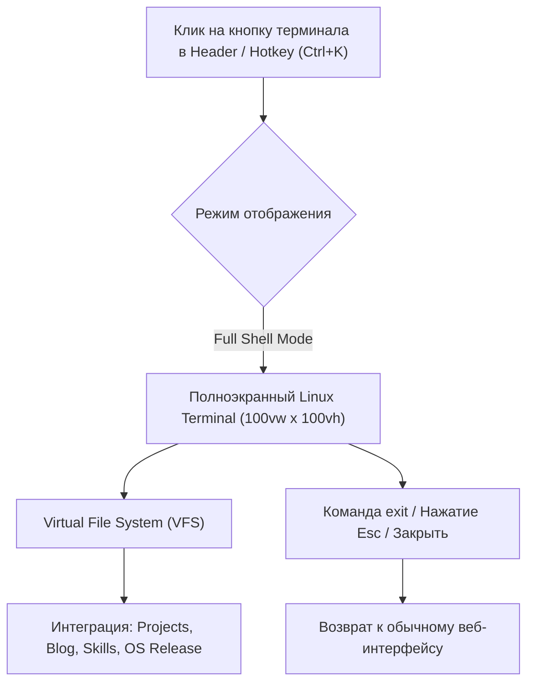

# Архитектурный план: Полноэкранный Linux-терминал (Immersive Shell Mode)

## 1. Концепция и UX-видение

При нажатии на кнопку терминала в Header (или по горячей клавише `Ctrl+K` / `Ctrl+\``) сайт переходит из графического веб-режима в **полноэкранный интерактивный Linux-терминал (TTY/Shell)**:
* Занимает весь экран (`100vw`, `100vh`) поверх GUI с плавным появлением.
* Аутентичный zsh/starship-промпт: `igni@archlinux:~$ ` с подсветкой синтаксиса и статус-кодами.
* Выход обратно в веб-интерфейс в любой момент через команду `exit`, нажатие `Esc` или клик по кнопке закрытия окна.



---

## 2. Архитектура виртуальной файловой системы (VFS)

Вся информация о вашем опыте, проектах и статьях представлена в виде реального дерева файлов и папок Linux:

```text
/
├── bin/                       # Доступные команды (ls, cat, cd, neofetch, clear, exit...)
├── etc/
│   └── os-release             # "Isotope Linux 2026.1 (LTS) - Zoneless Edition"
└── home/
    └── igni/                  # ~ (домашняя директория)
        ├── about/
        │   ├── bio.md         # Опыт, контакты, специализация
        │   └── skills.json    # Архитектурный стек
        ├── projects/          # Проекты (динамически синхронизируются из БД)
        │   ├── VortexDL.md
        │   ├── Arcania.md
        │   └── AUSWP.md
        └── blog/              # Статьи блога (динамически синхронизируются из БД)
            ├── harm-of-ai.md
            └── zoneless-angular.md
```

---

## 3. Поддерживаемый набор команд (Unix Toolchain)

### Навигация и файловые операции
* `pwd` — вывести текущую рабочую директорию.
* `cd [path]` — перейти в папку (`cd ..`, `cd ~`, `cd projects`, `cd /etc`).
* `ls [-la]` (или `ll`) — список файлов и папок с цветовой дифференциацией (папки синие, исполняемые файлы зеленые, документы белые, метаданные прав и размера).
* `cat [file]` — вывод содержимого файла (markdown, json, конфиги) с форматированием.
* `tree` — красивое ASCII-дерево текущей директории.

### Системная телеметрия и инфо
* `neofetch` / `fastfetch` — отображение ASCII-логотипа, конфигурации стека (OS, Host, Kernel, Uptime, Shell, CPU, Memory).
* `whoami` / `id` — информация о разработчике (`uid=1000(igni) gid=1000(developers) groups=1000(angular),1001(rust),1002(systems)`).
* `uptime` — реальное время работы сервера и рантайма.
* `uname -a` — строка ядра системы (`Linux isotope-node 6.12.0-zen #1 SMP PREEMPT ... x86_64`).
* `date` — текущая дата и время UTC.

### Управление сессией и утилиты
* `help` / `man [cmd]` — список доступных команд и справка.
* `clear` / `Ctrl+L` — мгновенная очистка экрана.
* `history` — история введенных команд.
* `open [project]` — открыть модальное окно выбранного проекта прямо из терминала.
* `theme [dark|matrix|amber]` — переключение цветовой палитры терминала.
* `exit` — закрыть терминал и вернуться в графический интерфейс.

---

## 4. Нативный Linux-интерактив (UX/DX)

1. **Tab Autocompletion (Автодополнение):**
   * При нажатии `Tab` автоматически дополняются имена доступных команд и файлов/папок в текущей директории.
   * При повторном `Tab` — отображение вариантов.
2. **История команд:**
   * Стрелки `↑` (Вверх) и `↓` (Вниз) перебирают историю ранее выполненных команд.
3. **Клавиатурные шорткаты:**
   * `Ctrl + C`: прерывание текущей строки и переход на новый промпт.
   * `Ctrl + L`: очистка экрана (аналог `clear`).
   * `Esc`: возврат в веб-интерфейс.

---

## 5. Пошаговый план внедрения

| Этап | Задачи | Результат |
| :--- | :--- | :--- |
| **Этап 1: Shell & VFS Engine** | Создание легковесного `VfsService` (структура дерева, пути, резолвер) и `ShellEngine` (парсер аргументов, роутер встроенных команд). | Независимый чистый движок командной строки. |
| **Этап 2: Полноэкранный UI** | Разработка полноэкранного оверлея (`TerminalFullscreenComponent`): автоскролл, скрытие фонового скролла страницы, автофокус инпута, заголовок в стиле Wayland/GNOME terminal. | Готовый UI на весь экран без дёрганий. |
| **Этап 3: Команды и интеграция данных** | Реализация `neofetch`, `ls`, `cat`, `cd`, `tree`, генерация виртуальных файлов из данных `ProjectsService` и `BlogService`. | Терминал наполнен реальным контентом сайта. |
| **Этап 4: Tab-комплишн и шорткаты** | Подключение автодополнения по клавише `Tab`, навигация по истории стрелками, шорткаты `Ctrl+C`, `Ctrl+L`, `Esc`. | Ощущение настоящего терминала в Linux. |
| **Этап 5: Подключение в Header** | Обновление `CliButtonComponent` в Header для вызова полноэкранного режима, верификация отсутствия layout shift. | Готовая рабочая фича на проде. |
